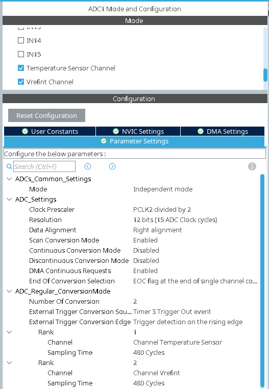
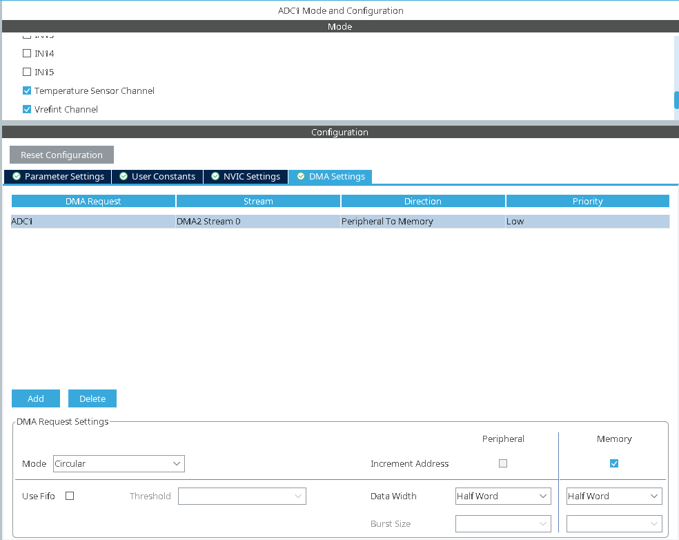
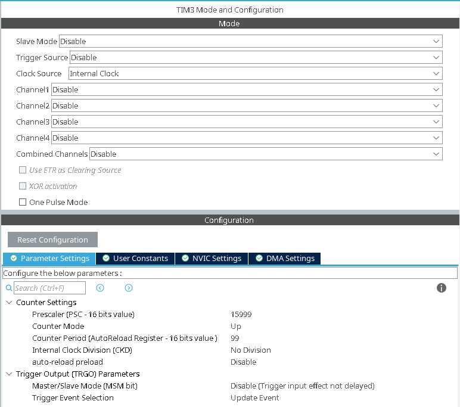
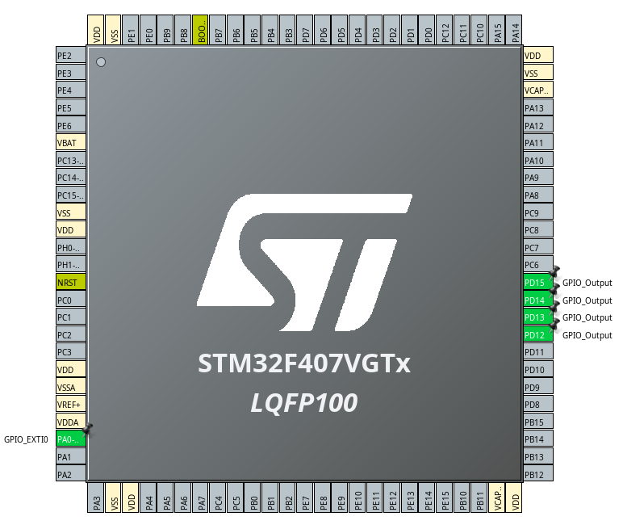

# INTERNAL TEMPERATURE MONITOR USING ADC AND DMA

## Calculations

$$
V_{DDA} = \frac{V_{REFINT\_CAL} \times 4095}{V_{REF\_AVG}}
$$

$$
V_{SENSE} = \frac{Temp\_avg \times V_{DDA}}{4095}
$$

$$
T_{C} = \frac{V_{SENSE} - V_{25}}{Avg\_slope} + 25
$$

* **V_{25}**: Sensor voltage at 25°C [0.76 V].
* **Avg_slope**: Rate at which the sensor's voltage changes per degree Celsius [0.0025 V/°C].
* **Vrefint_cal**: This is the internal reference calibration voltage [1.21 V].
* All constant values are present in datasheet.
  
## Configuration

### ADC Parameter Configuration

### ADC DMA Configuration

### TIM3 Configuration

### GPIO Configuration

Tick the EXTI line0 box in System Core -> NVIC

