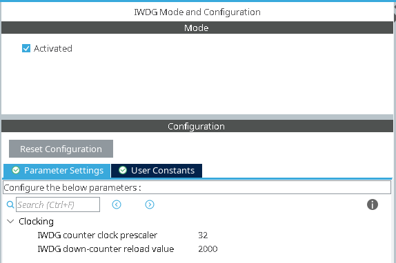
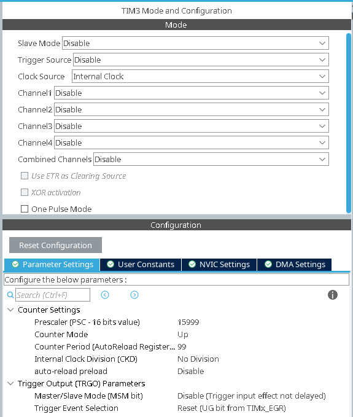
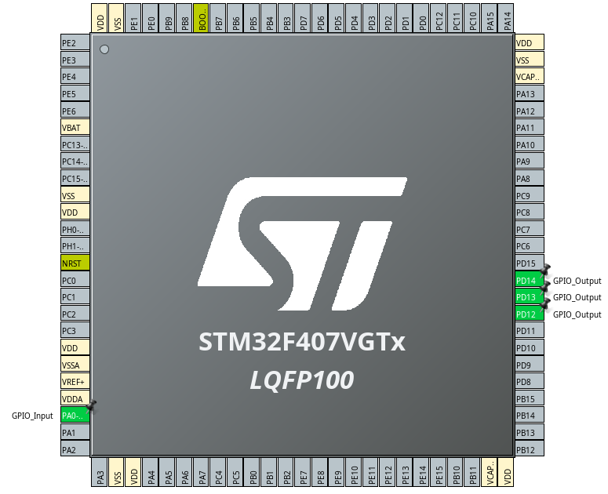

# WATCHDOG FAULT-RECOVERY CONTROLLER

## Configuration

### IWDG Configuration

### TIM3 Configuration

Tick the TIM3 global interrupt box in NVIC settings.

### GPIO Settings

Tick the EXTI line0 box in System Core -> NVIC.

